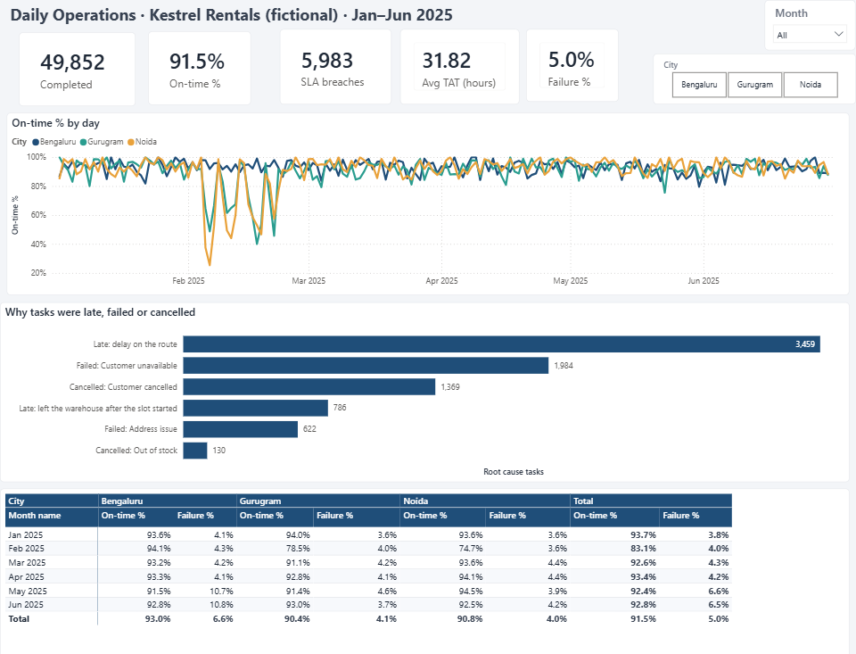
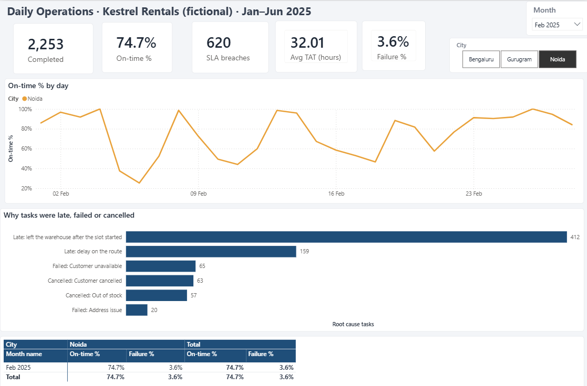
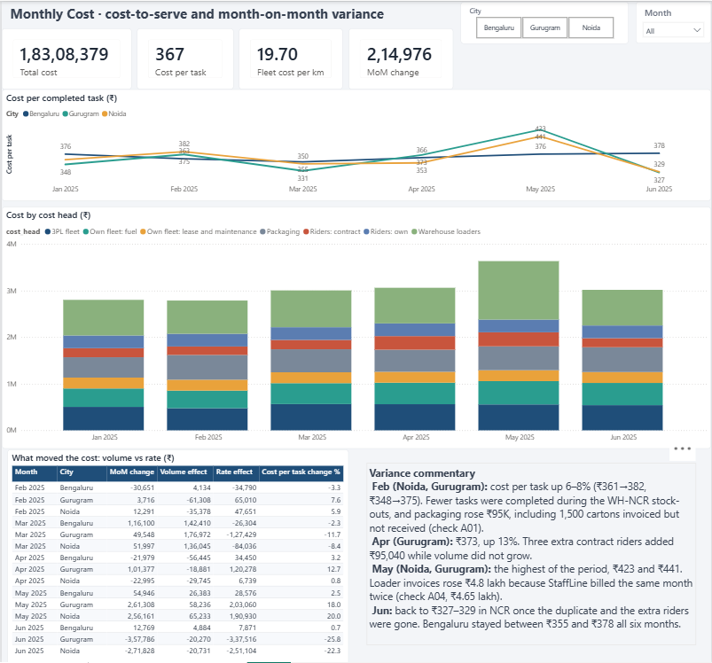
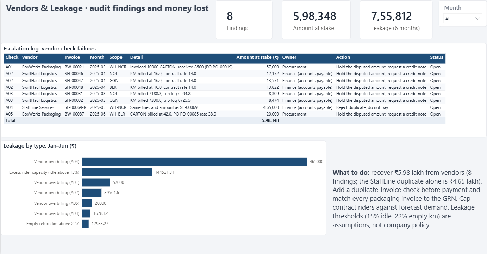
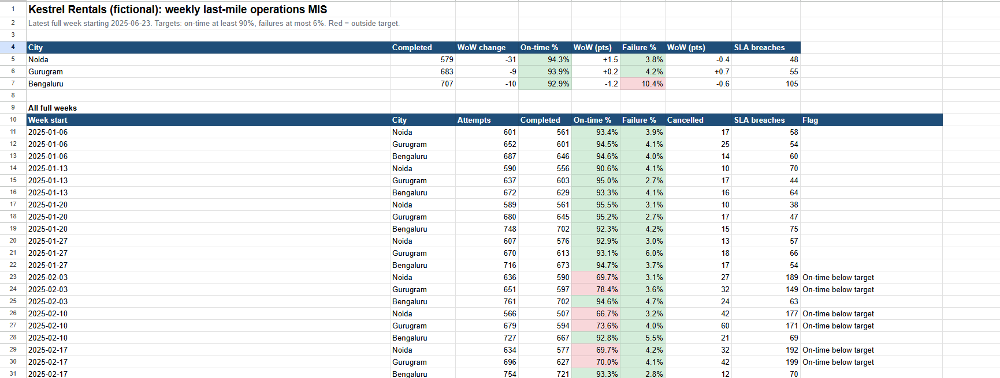
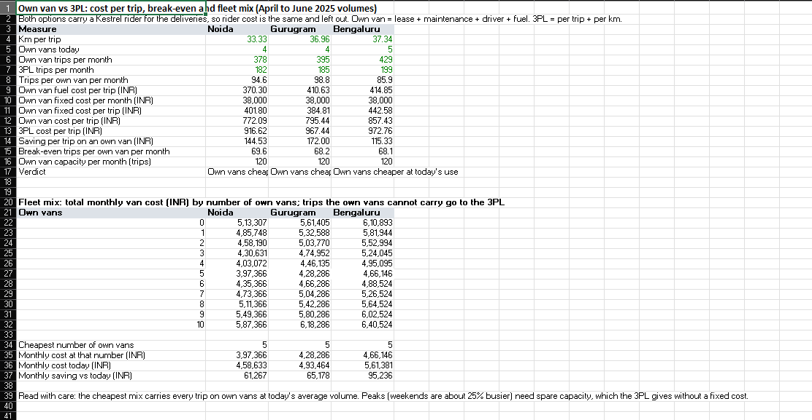
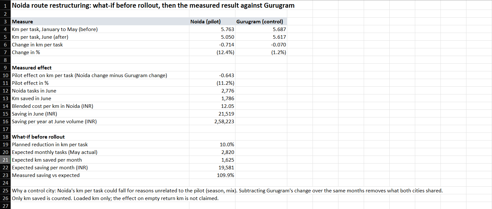

# Last-Mile Delivery Operations & Cost Analytics

Delivery performance, unit cost, vendor billing audit and operating decisions for **Kestrel Rentals**, a fictional furniture and appliance rental company with a last-mile operation in Noida, Gurugram and Bengaluru (January to June 2025).

> **All data is synthetic.** It was generated with planted problems (`docs/design.md`, section 5) so the analysis can be checked against a known answer. Company, vendors, riders and amounts are invented. This is a portfolio project, not work done for a real company.



## What it answers

| Question | Where |
|---|---|
| How is delivery performing, by city and day, and why do tasks run late, fail or get cancelled? | SQL views, Power BI page 1, weekly MIS |
| What does a delivery cost, and what moved the cost month on month (volume or rate)? | SQL views, Power BI page 2 |
| Are vendors billing what they should? | Vendor checks A01–A05, escalation log, Power BI page 3 |
| Where is money leaking, and how much? | Leakage views (idle riders, empty km, overbilling) |
| Own vans or 3PL? How many riders and vans for July–September? Did the Noida route pilot work? | Excel cost model |
| What should leadership decide? | `docs/leadership_review.md` |

## Results

| | Jan–Jun 2025 |
|---|---|
| Tasks completed / on time | 49,852 / 91.5% |
| Cost per completed task | ₹367 (total ₹1.83 crore) |
| Vendor overbilling found | ₹5,98,348 in 8 findings |
| Leakage sized | ₹7,55,812 |
| Route pilot effect (Noida vs Gurugram control) | −11.2% km per task, about ₹2.58 lakh a year |

Main findings:
- **February:** on-time fell to 74.7% in Noida and 78.5% in Gurugram. Root cause: stock-outs at the NCR warehouse; 786 tasks left after their slot had started, 130 orders were cancelled as out of stock.
- **May:** cost per task in Noida and Gurugram rose to ₹423 and ₹441. The variance split shows a rate effect, not volume: the loader vendor billed May twice (₹4.65 lakh).
- **Bengaluru from May:** failed attempts went from about 4% to 10.7% after slots moved to 8:00 and 9:00, which fail 16–17% of the time (customer unavailable).
- **Gurugram April–May:** 9 riders where 6 were needed; idle time 27–29%. Nine is the right number for September, so they were hired about four months early.
- **Fleet:** an own van is cheaper per trip than the 3PL in every city (₹772–857 vs ₹917–973); 5 own vans per city is the cheapest mix.

## How it is built

```
src/generate_data.py      synthetic source files + answer key (seed 2025)
        ↓
src/load_data.py          PostgreSQL database `lastmile`: schemas ref, ops, vnd, rpt; 16 tables
        ↓
sql/02–06                 metric views: performance, root causes, productivity, unit costs,
                          month-on-month variance, vendor checks A01–A05, escalation log, leakage
        ↓
src/export_reporting.py   17 views → reporting/*.csv
        ↓
 ├─ src/build_cost_model.py → excel/ops_cost_model.xlsx   fleet economics, forecast, pilot (292 formulas)
 ├─ powerbi/lastmile_ops_cost.pbix                         3 report pages + a checks page
 ├─ gsheets/weekly_mis.gs                                  weekly MIS in Google Sheets, refreshed every Monday by an Apps Script trigger
 └─ docs/leadership_review.md                              one-page review and decisions
        ↓
tests/                    38 pytest tests
```

Every metric is defined once in SQL (`docs/design.md`, section 3) and the reports read the same views, so the numbers agree everywhere.

## Checks

- **38 tests** (`tests/`):
  - every planted problem is found, with the exact amount for vendor findings and nothing extra
  - pandas recalculates the monthly rates, all five vendor checks, rider and fuel costs and the pilot effect straight from the raw files, without the SQL views
  - every source row is loaded, every task that was not on time has exactly one root cause, the cost views agree, volume + rate effect equals the month-on-month change, and the exported CSVs match the database
- **Power BI checks page:** all 18 measures match the SQL totals.
- **Excel:** recalculated with 0 formula errors.

## Screenshots

**February in Noida: the stock-out days and their root cause**


**Monthly cost: cost per task, cost by head, volume vs rate variance and commentary**


**Vendors and leakage: escalation log and leakage by type**


**Google Sheets weekly MIS with flags against targets**


**Excel: own van vs 3PL, break-even and fleet mix**


**Excel: route pilot measured against a control city**


## How to run

Requires Python 3.11+ and PostgreSQL. The scripts ask for the database password once and do not store it.

```
pip install -r requirements.txt
python src/generate_data.py
python src/load_data.py --port 5432
python src/show.py ops --port 5432            # also: causes, productivity, costs, vendors, leakage
python src/export_reporting.py --port 5432
python src/build_cost_model.py
python -m pytest -s -v tests --port 5432
```

Power BI: open `powerbi/lastmile_ops_cost.pbix` and point the PostgreSQL source at your server. The theme is `powerbi/kestrel_ops_theme.json`.

Google Sheets: upload `reporting/daily_ops.csv` and `reporting/escalation_log.csv` to a Drive folder named `kestrel-reporting`, paste `gsheets/weekly_mis.gs` into Extensions → Apps Script of a new sheet, run `refreshMIS`, then `createWeeklyTrigger`.

## Repository

| Path | Contents |
|---|---|
| `docs/design.md` | Scenario, data, metric definitions, vendor checks, planted problems |
| `docs/data_dictionary.md` | Tables and reporting views |
| `docs/leadership_review.md` | One-page review and decisions |
| `data/raw/` | Generated source files |
| `data/answer_key/` | Expected findings, used only by the tests |
| `sql/` | Schema and views, run in order by the loader |
| `src/` | Generator, loader, reports, export, Excel builder |
| `reporting/` | Exported views (CSV) |
| `excel/`, `powerbi/`, `gsheets/` | Cost model, dashboards, weekly MIS script |
| `tests/` | pytest suite |

## Assumptions and limits

- Assumptions not in the data, marked yellow in the Excel model: an own van needs a driver (₹20,000 a month), at most 4 trips per van per day, 15% rider idle allowance, 22% empty-km threshold, 10% planned pilot reduction.
- The forecast is a straight-line trend on 25 weeks; it does not include festival-season peaks.
- The pilot has one month of data, and only variable km cost is counted.
- No real TMS, WMS, GPS or vendor contracts; the project shows the analysis and the controls.
